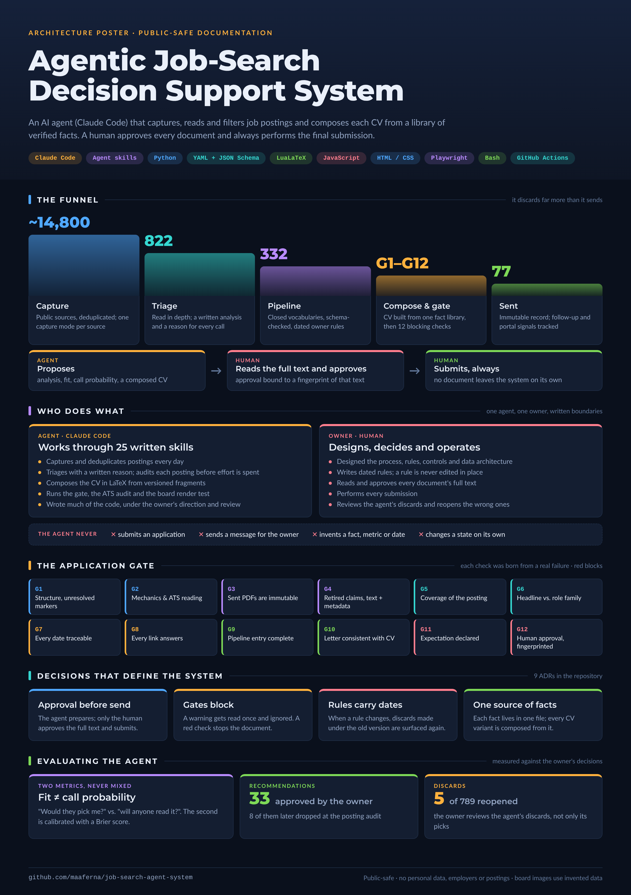
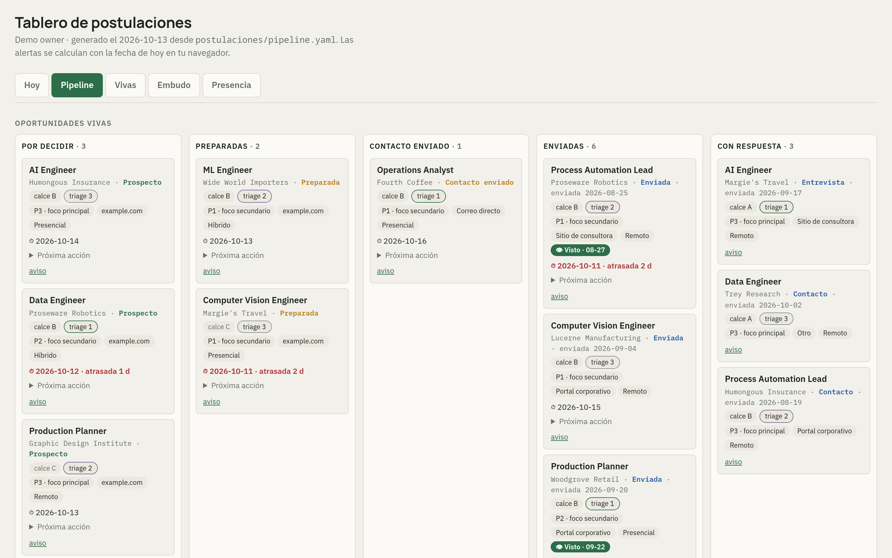
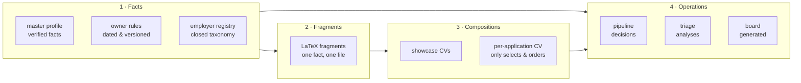
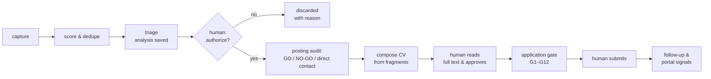

# Job Search Agent System

[](https://claude.com/claude-code)
[](reference/)
[](.github/workflows/ci.yml)
[](examples/data/)
[](LICENSE)

**An agentic decision-support system for a job search:** capture postings, triage them against explicit
rules, compose each CV from a library of verified facts, pass it through quality checks and record every
decision — with a human reading and approving every document, and making every submission.

[Architecture](docs/architecture.md) · [The board](docs/board.md) · [Audits](docs/audits.md) ·
[Quality controls](docs/quality-controls.md) · [Decisions (ADR)](docs/decisions/) ·
[Lessons](docs/lessons.md) · [Examples](examples/) · [Reference code](reference/) ·
[One-page poster](docs/img/poster-architecture.png)

> <a id="lector-no-tecnico"></a>**Para el lector no técnico.** Este repositorio describe un sistema que
> su autor usa a diario para gestionar su propia búsqueda de empleo junto a un agente de IA (Claude Code).
> El sistema encuentra avisos, los evalúa contra reglas escritas, arma cada CV desde una biblioteca de
> hechos verificados, lo revisa con controles automáticos y registra cada decisión. **Ningún documento
> sale sin que el autor lea y apruebe su texto completo, y el envío siempre lo hace el autor.** El sistema
> descarta muchas más oportunidades de las que llegan a enviarse: unos 14.800 avisos vistos, 822
> analizados por escrito y 77 postulaciones enviadas. No es un bot que postula en masa. El sistema real es
> privado porque contiene datos personales; aquí se publica cómo está diseñado, con capturas generadas con
> **datos inventados**. Para empezar: [el póster](docs/img/poster-architecture.png), que resume el
> sistema en una página; [el tablero](docs/board.md), que muestra el trabajo diario; y
> [las lecciones](docs/lessons.md), que cuentan qué falló y qué control nació de cada falla (en inglés,
> como el resto del repositorio).

## What this project demonstrates

<a href="docs/img/poster-architecture.png"></a>

- **Governing an agent, not just using one.** Written procedures (skills), explicit boundaries, a human
  approval bound to a fingerprint of the approved text, and rules the agent must cite with their date.
- **Controls that block, and evaluation that is honest.** Twelve per-application checks, a test that
  compares what a page *shows* with what the data says, a calibrated probability (Brier score), the
  measured reliability of a small local model — and a written list of what is *not* checked.
- **Data design for decisions.** Every fact lives in one file, closed vocabularies validated by a schema,
  dated rules that reopen old decisions, sent documents kept as immutable records.

**Start here**

- *Recruiters:* [the one-page poster](docs/img/poster-architecture.png) → [the board](docs/board.md) →
  [lessons](docs/lessons.md) → [what the agent may and may not do](docs/agent-operating-model.md#boundaries--what-the-agent-never-does).
- *Engineers:* [architecture](docs/architecture.md) → [posting lifecycle](docs/posting-lifecycle.md) →
  [audits](docs/audits.md) → run [`reference/gate.py`](reference/) and the [LaTeX example](examples/latex/).

<br clear="right">

<picture>
  <source media="(prefers-color-scheme: dark)" srcset="docs/img/board-pipeline-desktop-dark.png">
  
</picture>

<sub>The board's pipeline view, rendered by the real generator from <a href="examples/data/pipeline.example.yaml">invented data</a>. The interface is in Spanish: <i>calce A/B/C</i> = fit band · <i>triage 1–3</i> = priority given when the entry was created · <i>P1–P3</i> = search profile · <i>Por decidir / Preparadas / Enviadas</i> = to decide / prepared / sent. More views: <a href="docs/board.md">docs/board.md</a>.</sub>

**Status:** private system in daily use since August 2026; this repository is its public documentation ·
**Data:** everything shown here is invented · **Code:** [reference implementations](reference/) written
from scratch for this repository, by the agent under the owner's review; the private code is not
published · **License:** documentation [CC BY 4.0](LICENSE), code [MIT](LICENSE-CODE).

**Contents:** [What it does](#what-it-does--and-what-it-does-not) · [Stack](#stack) ·
[Architecture](#architecture-in-one-page) · [Life of a posting](#the-life-of-a-posting) ·
[Numbers](#numbers-measured-on-2026-10-13) · [Repository map](#repository-map) ·
[Run it](#run-the-reference-code) · [Kept clean](#how-this-repository-is-kept-clean) · [Author](#author)

---

## What it does — and what it does not

| It does | It does not |
|---|---|
| Captures postings from public sources and scores them against written criteria | Apply to anything on its own, or click *send* |
| Keeps a written analysis of every posting it reads in depth, so nothing is analyzed twice | Send a document without the owner reading and approving its full text |
| Composes each CV from a fact library where **every fact lives in exactly one file** | Invent a metric, a date or a skill — missing facts are asked, never filled in |
| Blocks a document that fails a quality check (retired claims, unreadable text, broken links) | Hide a failing check — exceptions are explicit and recorded |
| Records each opportunity in a state machine with closed vocabularies | Decide: the owner makes every go / no-go and every submission |
| Works in a browser session the owner opened, under the owner's supervision | Log in, solve CAPTCHAs or get around rate limits on any site |

**Who did what.** *The owner* is the candidate: the person who designed the system and uses it for
their own search. The agent is [Claude Code](https://claude.com/claude-code). The owner designed the
process, the rules, the controls and the data architecture, and operates the system daily. Much of the
code was written by the agent under the owner's direction and review. This is work *with* an agent, not
hand-written code.

## Stack

| Layer | Tools | Used for |
|---|---|---|
| **Agent** | [Claude Code](https://claude.com/claude-code) — skills, hooks, memory, project instructions (`CLAUDE.md`) | judgment work: reading a posting against the profile, composing, reviewing; orchestration of the daily procedure |
| **Documents** | LaTeX (LuaLaTeX, `fontspec`, `hyperref`), poppler (`pdftotext`, `pdfinfo`, `pdffonts`), `qpdf`, Pandoc | CVs and letters composed from fragments; ATS checks on the built PDF; `.docx` backups |
| **Automation** | Python 3 (standard library + PyYAML), Bash | capture, scoring, gates, metrics, generators, repository QA — the half that runs without the agent |
| **Browser** | JavaScript (Node.js) with Playwright-core on the system's Chrome | headless capture of sites that need a browser; the rendered-board test; screenshots |
| **Board** | HTML, CSS and plain JavaScript generated by Python — no framework, no build step | the daily view: one self-contained page with its data embedded |
| **Data** | YAML and Markdown in git | pipeline, triage, owner rules, fact library: plain text, diffable, validated by scripts |
| **Local model** | Ollama (a 3B model on CPU) | some reading tasks when there are no agent credits |
| **CI** | GitHub Actions | sanitization gate, link check, schema check, unit tests, rendered-page test (this repository) |

## Architecture in one page



Dependencies flow **one way**: facts → fragments → compositions → operations. A composition never
contains a fact; it only chooses fragments and their order. Correcting a fact means editing one file.
Details: [`docs/architecture.md`](docs/architecture.md).

## The life of a posting



Every arrow that crosses into a submission passes through a human. Details:
[`docs/posting-lifecycle.md`](docs/posting-lifecycle.md).

## Numbers (measured on 2026-10-13)

| | |
|---|---|
| Period of active development | August 2026 → today |
| Commits (small, reviewed) | 876 |
| Agent skills (written procedures) | 25 |
| Scripts | 35 |
| Repository QA blocks (`check.sh`) | 25 |
| Per-application quality checks | 12 |
| Unique postings seen from public sources | ~14,800 |
| Postings analyzed in writing (triage) | 822 |
| Opportunities recorded in the pipeline | 332 |
| Documents actually sent | 77 |
| Agent recommendations the owner authorized / later dropped at the posting audit | 33 / 8 |
| Agent discards the owner reopened | 5 of 789 |

**For every document sent, more than ten opportunities were discarded with a written reason**
(about a thousand discards between triage and pipeline), and none was sent without the owner approving
its full text.

**The agent is evaluated against the owner's decisions, in both directions.** Its picks: the owner
authorized all 33 of its recommendations; 24 were sent and 8 were dropped later, at the posting audit
(GO / NO-GO). Its discards — the error that is easiest to miss, since nobody looks at a posting again once
it is discarded: the owner reopened 5 of 789. See [`docs/metrics.md`](docs/metrics.md) for definitions, how each number is
recomputed, and the calibration of the call probability.

## Repository map

| Document | What it explains |
|---|---|
| [`docs/architecture.md`](docs/architecture.md) | The four layers and why dependencies go one way |
| [`docs/board.md`](docs/board.md) | The generated board, view by view, with screenshots of invented data |
| [`docs/posting-lifecycle.md`](docs/posting-lifecycle.md) | From capture to follow-up, step by step |
| [`docs/state-machine.md`](docs/state-machine.md) | Pipeline states, who closed a process and why, closed vocabularies |
| [`docs/audits.md`](docs/audits.md) | Every audit by what it protects: ATS mechanics, truth and coherence, judgment — and what is not audited |
| [`docs/quality-controls.md`](docs/quality-controls.md) | Repository QA, per-application gate, rendered-board test |
| [`docs/agent-operating-model.md`](docs/agent-operating-model.md) | Skills as procedures, dated rules, memory, hooks, authorization boundaries |
| [`docs/metrics.md`](docs/metrics.md) | Fit score vs. call probability: two numbers that are never mixed |
| [`docs/lessons.md`](docs/lessons.md) | Real failures turned into controls |
| [`docs/decisions/`](docs/decisions/) | Architecture decision records |
| [`examples/`](examples/) | Invented example data, the pipeline JSON Schema, seven translated agent skills, the [Claude Code settings and hooks](examples/claude/), local-model prompts, a `CLAUDE.md` template, and a [compiling LaTeX example](examples/latex/) of fragments and compositions |
| [`reference/`](reference/) | Working minimal versions of six mechanisms: closed-vocabulary validator, dated rules, fit and call probability, per-application gate, ATS coverage, rendered-page test |
| [`tools/`](tools/) | How the published images are produced: board screenshots from invented data, CV previews, the architecture poster — each gated before it is written |

## Run the reference code

```bash
python3 -m venv .venv && . .venv/bin/activate && pip install -r requirements.txt
python3 reference/gate.py reference/fixtures/applications/blocked   # the gate refusing an application
python3 reference/dated_rules.py                                    # a discard that a rule change reopened
python3 -m unittest discover -s tests -t .                          # all tests (also run in CI)
npm ci && node reference/render_test.mjs                            # the page shows what the data says
./examples/latex/build.sh all                                       # three CVs from one fragment library
make check                                                          # everything CI runs
```

## How this repository is kept clean

Nothing here is copied from the private repository: everything is rewritten, and a sanitization gate
([`scripts/sanitize_check.py`](scripts/sanitize_check.py)) runs before every commit and in CI. It searches
for amounts, emails, IDs and phones, and — on the owner's machine — for every employer and contact name
of the private pipeline, from a local denylist that is never committed (the list would leak what it
protects). Images cannot be searched, so each one carries a manifest with its hash and visible text
([ADR 0009](docs/decisions/0009-board-published-as-synthetic-screenshots.md)).

## Author

Marco Antonio Parra Fernández — industrial engineer working on applied AI, data and automation for
physical operations · [LinkedIn](https://www.linkedin.com/in/marco-antonio-parra-82999337) ·
[GitHub](https://github.com/maaferna)

## License

Documentation under [CC BY 4.0](LICENSE); source code under the [MIT License](LICENSE-CODE).
