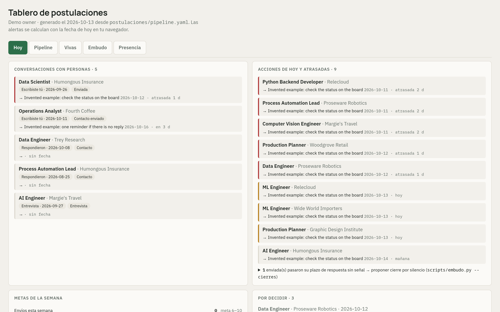
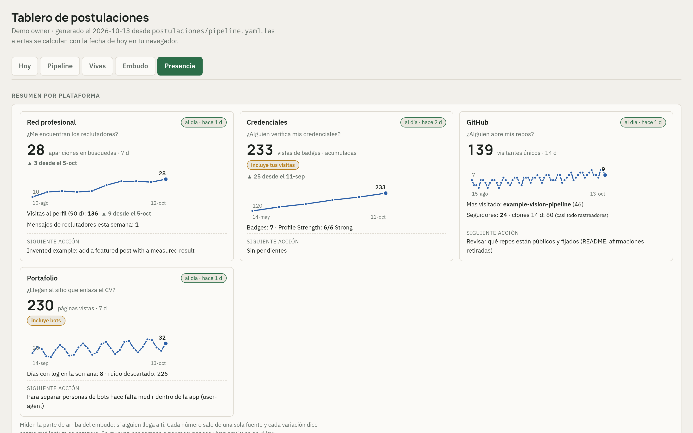
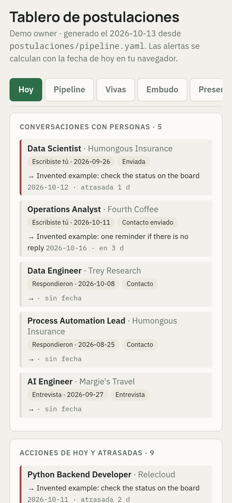
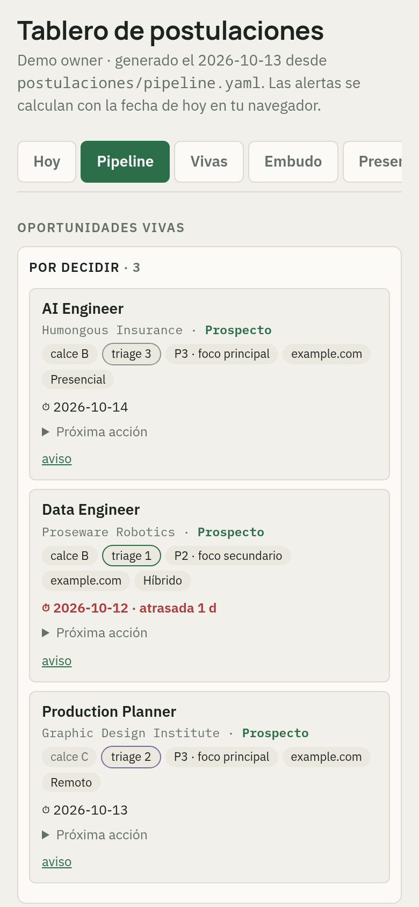
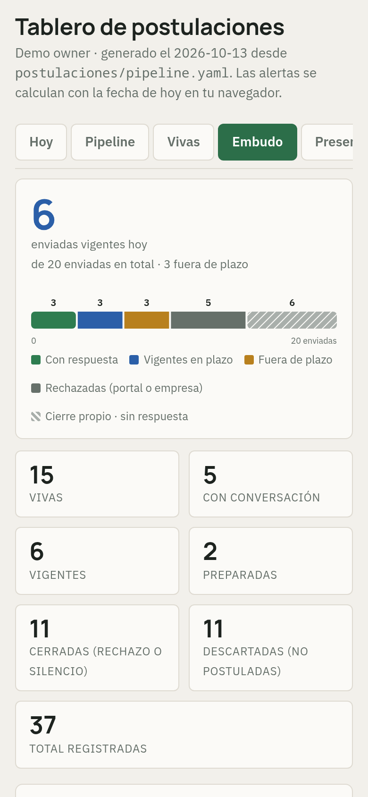
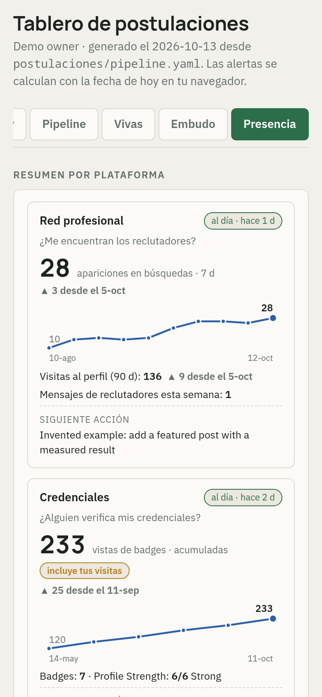

# The board

The board is a single HTML page **generated** from the pipeline, never edited by hand. It is the view the
owner opens every day: what needs an answer today, where every live opportunity stands, and whether the
funnel is working.

> **Every number and name in these pictures is invented.** They are screenshots of the real generator run on
> [invented data](../examples/data/pipeline.example.yaml) in a sandbox; the employer names are the fictional
> companies commonly used in software documentation. The interface is in Spanish, as it is in daily use. How
> the pictures are produced and checked:
> [ADR 0009](decisions/0009-board-published-as-synthetic-screenshots.md).

## Today (*Hoy*)

<picture>
  <source media="(prefers-color-scheme: dark)" srcset="img/board-today-desktop-dark.png">
  
</picture>

Four panels, in the order the day is worked:

- **Conversations with people** (*Conversaciones con personas*) — only entries where a person is involved,
  outgoing ("you wrote") or incoming ("they replied"). A portal signal is not a conversation.
- **Actions due today and overdue** (*Acciones de hoy y atrasadas*) — every `action_date <= today`, red when
  late. Below, the sent applications past their response window, **proposed** for an own closure — the
  board never closes anything.
- **Weekly goals** (*Metas de la semana*) — computed against the goals file, never written by hand.
- **Waiting for a decision** (*Por decidir*) — authorized prospects nobody has worked yet.

Alerts are computed with the date in the reader's browser, so the page does not go stale between
generations.

## Pipeline

<picture>
  <source media="(prefers-color-scheme: dark)" srcset="img/board-pipeline-desktop-dark.png">
  
</picture>

Only what is alive, in five columns that follow the [state machine](state-machine.md). Each card shows
the **fit band** (*calce A/B/C*, the employer's view) and the **triage priority** (*triage 1–3*) given
when the entry was created — plus search profile (*P1–P3*), channel, modality and the next action.
Closed and discarded entries live in a searchable list below, not in the columns: they once accounted
for most of the page's size. The board has one more view, *Vivas* (live), which lists the same live
entries as a table; it is not shown here.

## Funnel (*Embudo*)

<picture>
  <source media="(prefers-color-scheme: dark)" srcset="img/board-funnel-desktop-dark.png">
  
</picture>

From top to bottom:

- **Composition of what was sent**: with a reply, live within the window, past the window, rejected (by the
  board or the employer), own closure. Rejections and own closures are different bars because they mean
  different things ([closures](state-machine.md#two-questions-every-closure-answers)).
- **Funnel and response rate.** The rate counts only sent applications; discards are not in the
  denominator. "Response" has one definition, shared with the funnel script.
- **Goals and gaps.** The gaps most repeated across postings are what the market asks for that the profile
  lacks — the input for what to study. Next to them, the **call-probability calibration**: predicted call
  probability vs. observed, with its Brier score ([metrics](metrics.md)).
- **Per channel**: submissions, replies, rate, rejections, silences. The channel comes from a closed
  vocabulary; in the private system it names each job board.
- **Weekly activity**: each week's submissions colored by how they stand *today*, and the events the
  market returned.
- **What is about to expire**: each live application placed on its response window, so a silence is closed
  on schedule and not by impatience.

The location map of the real board is hidden in these pictures.

## Presence (*Presencia*)

<picture>
  <source media="(prefers-color-scheme: dark)" srcset="img/board-presence-desktop-dark.png">
  
</picture>

The top of the funnel: *does anybody reach the candidate?* One card per platform, and each card answers
**one question** with **one number from one source**:

| Card | Question | Main number |
|---|---|---|
| Professional network | Do recruiters find me? | appearances in searches, last 7 days |
| Credentials platform | Does anybody verify my credentials? | badge views, cumulative (it counts the owner's own visits too, and says so) |
| Code host | Does anybody open my repositories? | unique visitors, 14 days — clones are mostly crawlers |
| Portfolio | Do they reach the site the CV links to? | page views, 7 days (it includes bots, and says so) |

Every variation says **against which reading** it is compared ("▲ 3 since 5 Oct"), and every card has a
freshness chip: platforms keep some of these numbers only for days, so a reading older than its cadence
turns red. Below the cards: the portal signals of the applications by strength (read → CV downloaded →
process advanced), the profile's sections and posts, and the weekly signals log.

These series are **generated** ([`tools/presence_fixture.py`](../tools/presence_fixture.py)); the real view
reads the owner's own metrics and would never be published. Before capturing, job-board names and the names of
the platforms are replaced on the page by generic labels (*red profesional*, professional network;
*credenciales*, credentials); the metrics of the real view are read by the owner on their own profiles.

## On a phone

| Today | Pipeline | Funnel | Presence |
|---|---|---|---|
|  |  |  |  |

## The test that guards the page

Validating the data was not enough: for weeks the page showed things the data did not say — a modality
guessed from free text, two different response rates, duplicated alerts — while every data check was
green. Since then a headless browser opens the generated page on desktop and mobile, reads what each view
**shows**, and compares it with what a second implementation in Python says it must show. The page is not
republished while the test is red ([quality controls](quality-controls.md)). A small working version of
that test is in [`reference/render_test.mjs`](../reference/render_test.mjs).
