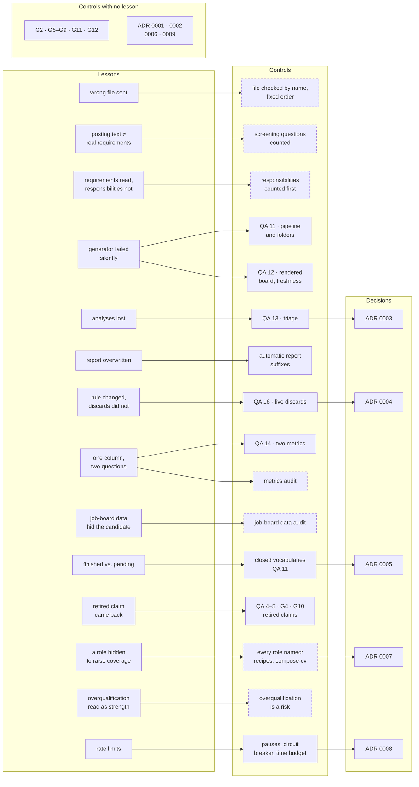

# Lessons — real failures turned into controls

Each lesson is a real failure and the control it produced; the map first shows them side by side. The
failures are described generically: no employer, person or posting is identifiable.

**If you read three:**
[the wrong file was attached](#the-document-that-was-sent-was-not-the-one-that-was-composed) ·
[a changed rule did not reopen its discards](#a-rule-changed-the-discards-it-justified-did-not) ·
[overqualification read as a strength](#overqualification-was-read-as-an-advantage).

## Which failure produced which control

Not every control came from a failure, and not every failure produced a check a script runs. The map below
shows both. A solid border is a control a script runs; a dashed border is a written procedure the agent
follows and the owner reviews — nothing fails automatically if it is skipped. The box *Controls with no
lesson* holds the ones that came from a design decision, not an incident.

Read it two ways. Six of the fourteen lessons produced only a procedure, so they depend on the agent
following it and the owner noticing when it does not. And most of the per-application gate — and the
approval of the full text itself (ADR 0001) — came from design, before any incident: the gate was built
to prevent failures, not only to answer them.

## The document that was sent was not the one that was composed

**What happened.** A one-click application form attached the *first* file of the candidate's uploaded
list, not the tailored CV. Another time, a one-click form had no extra questions: the "review" step went
straight to "submit", and the application left with a CV composed for a different employer. That job
board does not allow replacing the file.

**Control.** Before any submission, the file shown on the form's review screen is checked by name. And
the order of operations is fixed: compose → owner approves → load the right CV → only then read the
form's questions. Never open a form "just to see the questions" with a placeholder file loaded.

## The posting's text was not the real list of requirements

**What happened.** A posting described its requirements softly ("continuous improvement, Lean, Six Sigma
or equivalent"); the audit read them as soft and gave a GO. The application form asked for *years* of
each, plus years in the client's industry: three zeros.

**Control.** When a form has screening questions, they are read (with the right CV already loaded) and
counted: two or more questions answered "no" or "0" honestly turn the verdict into NO-GO, or into an
explicit low-probability bet.

## A role was recommended from its requirements, not its responsibilities

**What happened.** The requirements fitted; the day-to-day work was coordination of an ERP rollout with
almost no data, automation or models — the opposite of the career focus. The owner caught it before the
gate did.

**Control.** Count responsibilities (strength / partial / empty) before scoring fit; for project-type
roles, a written mandate: the role must include data, automation or a model that can be shown.

## A generator failed silently for three days

**What happened.** An application folder existed without its pipeline entry. The board generator
refused to run — but it was always invoked with its output silenced, so the published board froze for
three days and nobody noticed.

**Control.** Never silence a generator that can fail without writing. The repository QA now checks that
every folder has an entry and vice versa, and that the board is newer than its source.

## A second report on the same day overwrote the first

**What happened.** A capture was run again by hand on the same day, and its report replaced the first one
under the same name; the postings only the first run had seen were never reviewed.

**Control.** Reports get automatic suffixes (`b`, `c`…) and the daily procedure reads all of them.

## Analyses were lost when nobody answered

**What happened.** The radar recommended six postings; the session moved on without answering the
authorization question, and five analyses existed nowhere. The radar had already marked them as seen.

**Control.** The triage file: every analysis is saved *before* asking. Pending ones reappear at the top of
the next report without being re-analyzed ([ADR 0003](decisions/0003-triage-separate-from-pipeline.md)).

## One column, one question

**What happened.** A single "call probability" column mixed fit with channel and two scales; the best-fit
posting ranked below worse ones, and a panel kept re-estimating it by hand.

**Control.** Two metrics — fit (employer's view) and call probability (channel × fit × competition) — and
an audit that asks of every column: one question? one scale? comparable across rows? does it age while
displayed as fixed? does anyone recompute it by hand? ([metrics](metrics.md)).

## A status said "finished" and the board said "pending"

**What happened.** Processes that a job board had already closed automatically were recorded as "no
response", and the board showed them as still waiting.

**Control.** Closures record **who** closed (board / employer / own) and **why**, in a closed vocabulary.
An automatic "finished" is a rejection, not a silence ([state machine](state-machine.md),
[ADR 0005](decisions/0005-closed-vocabularies.md)).

## Data declared in a job board's profile made the candidate invisible

**What happened.** On one job board, a structured field held a wrong value for one of the candidate's
credentials; sixteen applications went out through that board before anyone looked at the form data
instead of the CV.

**Control.** A periodic audit of the *structured data* each job board holds (degree status, dates, roles,
salary field, seniority) against the master profile — with a checklist script.

## A rule changed; the discards it justified did not

**What happened.** The owner reopened a category of roles for the home city, but discards made under the
old rule stayed discarded, including one whose posting was still open.

**Control.** Owner rules are dated data; a script lists live discards that cite a superseded rule
([ADR 0004](decisions/0004-dated-owner-rules.md)).

## A retired claim traveled again

**What happened.** Several claims were removed from the CV on purpose (a figure later re-measured more
conservatively, a hardware detail, a project name). Keeping them out depended on someone remembering what had
been removed, and copying an older paragraph into a new fragment is enough to bring one back.

**Control.** A list of retired claims, searched in the text **extracted from every PDF**, in the sources,
in the `.docx` backups and in the PDF metadata. The script does not forget.

## Rate limits are a design input

**What happened.** One morning a public search endpoint started answering *429 Too Many Requests*. The
capture script retried each query with long waits and kept going through ~300 queries: the background
capture took about an hour, looked frozen (the log only showed final failures) and, in the end, brought
back half of the usual results.

**Control.** Measure before cutting: one of four search locations returned almost exactly the same
postings as another, so it was removed (~100 fewer queries per run). Then: a randomized pause between
queries, a circuit breaker after three consecutive throttled queries (counting throttles that succeeded on
retry), a time budget, interleaving queries across locations so a cut loses the tail of the list instead of
a whole location, and a progress line in the log. The limit is respected, never evaded.

## A higher coverage score hid a role

**What happened.** A CV variant for one application raised its coverage of the posting by several points
by leaving out an older role and a recent one. The score improved, and the timeline gained two
artificial gaps — in a profile where real gaps are already a risk a recruiter asks about.

**Control.** Every role is named in every CV; space is recovered by shortening text, never by removing a
role ([ADR 0007](decisions/0007-every-role-is-named.md)). The rule lives in the recipes and in the
composition procedure ([`compose-cv`](../examples/skills/compose-cv/SKILL.md)); no script checks it yet.

## Overqualification was read as an advantage

**What happened.** A posting asked for a technician-level profile with one year of experience; the
candidate had several times that experience and a graduate degree. The analysis had written the
distance down — as a strength. Nobody called. A recruiter reads overqualification as "will leave soon".

**Control.** If a posting asks for less than half of the candidate's experience, overqualification goes
to `risks` and lowers the seniority score.
