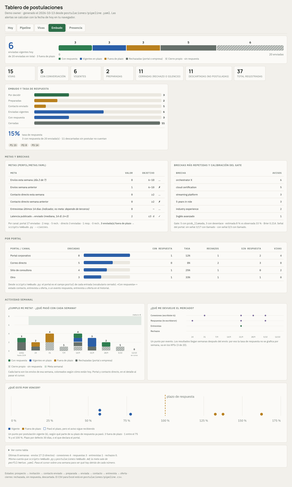

# Metrics

How the system scores an opportunity, measures the funnel and evaluates the agent, and where each
published number comes from. Every aggregate figure is also in [`numbers.yaml`](numbers.yaml).

## Two numbers that are never mixed

For a while a single column — "probability of being called" — tried to answer two questions at once:
*would the employer pick this candidate if they read the CV?* and *will anybody read it?* The owner
noticed the symptom: the posting with the best fit appeared **below** postings that fitted worse,
because those had a better channel. The column also mixed two scales (an early version started from an
assumed 25 % base rate for job boards; the measured one turned out to be about 2 %) and some values had
been written *after* sending.

The fix was to split it into two metrics with one question each
([lesson](lessons.md#one-column-one-question)):

### A · Fit (0–100) — the employer's view

Scored once, at the posting audit, and changed only if the facts change. It does **not** include channel,
pay, city or stability: those are the candidate's filters, not the employer's.

| Component | Points | How |
|---|---|---|
| **F**unctions | 0–35 | each function of the posting with evidence in the master profile: strength = 1, partial = ½ |
| **S**eniority | 0–25 | years asked vs. real years in that kind of work: equal or fewer → 25, +1 → 15, +2 → 5, +3 and +4 judged between 5 and 0, five or more → 0; overqualification −10 |
| **R**equirements | 0–25 | none missing → 25; one soft or "or related" → 15–20; one hard requirement missing → 5; two or more → 0 |
| **D**ifferentiator | 0–15 | domain knowledge competitors rarely have (physical operations, the plant floor, field computer vision) |

Stored as `fit` plus `fit_detail: "F/S/R/D"`, read in **bands**: A ≥ 75 · B 55–74 · C < 55. A score of 71
vs. 73 means nothing; the band does.

### B · Call probability — the channel's view

```
call_probability = base(channel) × m(fit band) × m(competition)
```

- **base(channel)** comes from measured rates, recomputed by the funnel script. On the first cycle:
  job boards ≈ **2 %**, direct contact with a person ≈ **43 %** (on very few cases: a direction, not a rate).
  The other bases (applicant tracking systems, public-sector processes) are estimates and are labeled as
  such.
- the multipliers are **judgment, not data** — with about a dozen outcomes nobody can calibrate them yet;
  the document says so and sets a review date.
- the value **at submission** is written once and never edited: it is what gets calibrated (Brier score)
  against outcomes. Values written after the fact are flagged and excluded from calibration.
- the value **today** is not stored: a script computes it from the clock and the portal signals (it
  decays after the window in which replies historically arrive, and rises with a "CV downloaded" signal).

A working version of both metrics, with the Brier score, is in
[`reference/probability.py`](../reference/probability.py).

### The decision rule

| Fit | Probability today | Action |
|---|---|---|
| A | low | open a channel with a person — the content fits, the channel is the problem |
| A / B | reasonable | wait; follow up on schedule |
| C | any | do not invest more |

## Funnel metrics

Computed by a script against goals stored in a YAML file (weekly submissions, direct contacts,
interviews, latency between a posting appearing and the application). Nobody writes these numbers by
hand in a report: if a report needs one, it runs the script.

| Metric | Definition |
|---|---|
| Submissions per week, by channel | entries with a `sent` date in the week |
| Response rate by channel / family / board | a "response" has **one** definition, shared by the board and the funnel script |
| Latency | days between a posting's publication and the submission |
| Call-probability calibration | predicted call probability vs. outcomes, excluding retroactive values |
| Gaps by frequency | normalized `gaps` across postings: what the market asks for that the profile lacks — the input for what to study next |

<a href="board.md#funnel-embudo"></a>

<sub>The same metrics on the board's <i>Embudo</i> (funnel) view, rendered from invented data and
explained in <a href="board.md#funnel-embudo">the board</a>.</sub>

## Repository numbers

Measured from the private repository on 2026-10-13 (read only):

| Metric | Value | How it is recomputed |
|---|---|---|
| Commits since the system started (Aug 2026) | 876 | `git rev-list --count --since=2026-08-01 HEAD` |
| Agent skills | 25 | count of skill folders |
| Scripts | 35 | count of files in `scripts/` |
| Repository QA blocks | 25 | count of block titles in `check.sh` |
| Per-application gate checks | 12 | G1–G12 |
| LaTeX fragments | 80 | count of `.tex` files in the fragment library |
| Radar reports | 74 | count of daily report files |
| Unique postings seen from public sources | ~14,800 | size of the radar's "seen" index |
| Postings analyzed in writing (triage) | 822 | entries in the triage file |
| Opportunities in the pipeline | 332 | entries in the pipeline: 256 discarded, 75 sent (open or closed), 1 prospect |
| Discarded with a written reason | 256 (pipeline) + 789 (triage) | entries with `state: discarded` / `verdict: discarded` |
| Documents sent | 77 | entries with a `sent` date — includes 2 later withdrawn and recorded as discarded |
| Tailored CV compositions | 76 | application folders with a composition; a few submissions went out with a showcase CV or as a direct message, and a few compositions were never sent |

**Reading:** about a thousand discards with a written reason against 77 documents sent, and no document
sent without the owner approving its text. That is the opposite of a mass-application bot.

## Evaluating the agent

The agent's judgment is measured against the owner's decisions, from the triage and pipeline files
(read only, 2026-10-13):

| Question | Measure |
|---|---|
| When the agent recommends a posting, does the owner agree? | 33 postings recommended (or flagged to investigate) after a written analysis; the owner authorized all 33 — agreement on what the agent picked; it says nothing about what it discarded (next rows) |
| …and does the recommendation survive the deeper audit? | 24 of the 33 were sent; 8 were dropped at the posting audit (GO / NO-GO), 1 is pending |
| How often does the owner overturn a discard? | 789 discards with a written reason; the owner reopened 5 (0.6 %) |
| Do corrections stick? | 56 memory notes record how the owner wants the work done; each correction is written once and applied in later sessions |

A discard the owner never looked at cannot be reopened, so the reopened share is a lower bound on
disagreement, not an accuracy.

What this does not measure yet: how often the per-application gate blocked a document the agent composed,
by check — the gate's results are not stored, only its final state.
