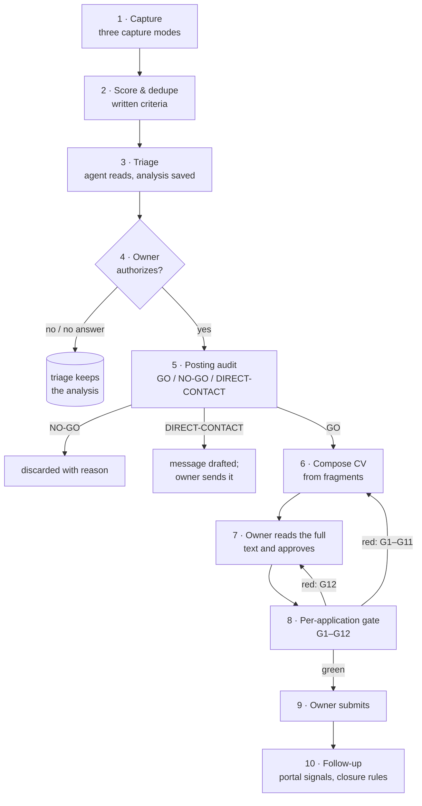

# The life of a posting

From the moment a posting is captured to the follow-up after sending. Every step that leads to a
submission passes through a human decision.



## 1 · Capture

Three capture modes, chosen by what each source demands
([ADR 0008](decisions/0008-capture-modes-by-source.md)):

| Mode | Sources | Runs |
|---|---|---|
| **Automatic** | public APIs and unauthenticated search pages; corporate career sites over HTTP | at session start, in the background (a hook) |
| **Headless browser** | corporate career sites that only render with JavaScript | weekly |
| **Assisted** | job boards that require a login or show a CAPTCHA | on demand; a visible browser window waits while the **human** solves the CAPTCHA |

The assisted mode never solves CAPTCHAs: it watches the window and continues when the person has solved
it, with a time limit per page. Rate limits are handled the same way — with pauses, a circuit breaker
and a time budget, never by evading them (see [lessons](lessons.md#rate-limits-are-a-design-input)).

## 2 · Score and deduplicate

Each posting gets a score against a written criteria file: target profiles with weighted terms,
locations, penalties (e.g. shifts outside the home region) and a title-noise pattern. A regression test
protects the scorer: a set of known postings must keep their expected scores after every change.

The score is **triage, not a decision**. A low score does not discard a posting that matches the focus,
and a high score does not justify applying. Postings seen before — in the pipeline or in a previous
report — are not shown again.

## 3 · Triage — the analysis is saved before asking

The agent reads the reported postings, validates each recommended one (is it still open? which
seniority does it really ask for? which hard requirements does the candidate not meet?) and writes an
entry in the triage file **before** asking the owner anything:

```yaml
# Invented example
- key: board:12345
  date: 2026-09-15
  title: Data Engineer
  verdict: discarded          # recommended | investigate | discarded
  reason: "core stack is a cloud warehouse the candidate has never operated; 5 years required"
  data: {years: "5", hard_requirements: "warehouse X", applicants: "", mode: "hybrid", pay: ""}
  promoted_to: ""             # pipeline id, once the owner authorizes
```

Pending analyses reappear at the top of the next report without being re-analyzed
([ADR 0003](decisions/0003-triage-separate-from-pipeline.md)).

## 4 · The owner authorizes, by name

Only the postings the owner authorizes by name enter the pipeline, as `prospect`. The one other way in is
an `invitation` from a job board, recorded so it can be declined with a reason
([state machine](state-machine.md)).

## 5 · Posting audit — GO / NO-GO before composing

Reading a posting is cheap; composing a tailored CV is not. The audit produces a verdict and the fit
score; the call probability is estimated with it and frozen when the document is sent. The two numbers
are never mixed ([metrics](metrics.md#two-numbers-that-are-never-mixed)):

- **GO** — in focus, reachable seniority, no missing hard requirement.
- **NO-GO** — with a one-line reason, so the radar never proposes it again (→ `discarded`).
- **DIRECT-CONTACT** — the content fits but the channel is poor (a one-click form, seniority at the
  edge): writing to a person beats the form (→ `outreach`).

It also asks two questions that were added after real misses:
- *Has this employer already screened the candidate out?* (an employer-history script flags repeated closures
  without a call).
- *Does the posting ask for much less than the candidate has?* Overqualification is a **risk**, not an
  advantage: recruiters assume the candidate will leave.

## 6 · Composition — one CV per posting, proposed by the agent

Every application gets its own CV, built for that posting. This is the step where the agent's reading of
the posting matters most — and where an agent is most tempted to embellish, so the design separates two
things: **choosing** is the agent's job, **facts** are not.

A per-application composition selects fragments and their order according to a **recipe** for the role
family (13 families, each with its fragments, ATS keywords and known gaps). The composition contains no
facts ([architecture](architecture.md)). The same role exists as fragments told from different sides —
software or operations, full or compressed — with the same employer, dates and figures, so the emphasis
can change without a fact changing.

| The agent | The owner |
|---|---|
| reads the posting and extracts its keywords, in its own words, marked required or desirable | — |
| picks the role family and takes its recipe; a tie goes to the family that closes more gaps with verified facts | accepts or changes the family |
| **proposes** the headline, the summary, which variant of each role, the order of the experience, the projects, the skills and the credentials — each with the line of the posting that motivated it | accepts, changes or rejects each choice |
| builds the PDF and measures coverage of the posting against the closest showcase CV | — |
| writes down the deviations from the recipe and the **open gaps**, with what can honestly be said about each | decides whether to apply with those gaps |
| proposes a new fragment when the library lacks a true sentence the posting needs | approves its text |

What never changes from one CV to another: dates, employers, job titles, verified metrics, credentials held,
and the fact that every role is named ([ADR 0007](decisions/0007-every-role-is-named.md)). A term the
profile does not support is never added to raise coverage: it goes to the gaps.

The agent hands all this over as a **composition report**, and records the deviations and open gaps in the
application's analysis, where the review reads them. The procedure is the
[`compose-cv`](../examples/skills/compose-cv/SKILL.md) skill, and an
[invented report](../examples/latex/compositions/applications/2026-10-12-contoso-data-engineer/composition-report.md)
shows one for a Data Engineer posting. In that example the tailored CV covers 81 % of the posting's
relevant terms, against 65 % and 74 % for the two showcase CVs built from the same facts; the orchestrator
the posting requires stays missing in all three, because the candidate does not have it.

<a href="../examples/latex/"></a>

<sub>A per-application CV composed from the <a href="../examples/latex/">invented fragment library</a>: same
facts as the showcase CVs, different selection and order.</sub>

## 7 · Human review of the full text

A preview script prints the CV section by section, marking the origin of each block (library fragment or
text written for this application) and flagging every number. The owner reads it and, only with an
explicit OK, the approval is recorded together with a **fingerprint of the approved text**. If the text
changes afterwards, the approval no longer matches
([ADR 0001](decisions/0001-human-approval-before-send.md)).

## 8 · Per-application gate

Twelve checks per application, from unresolved placeholders to the owner's approval fingerprint; a red check
blocks the document ([quality controls](quality-controls.md)). The gate runs **after** the review: its last
check, G12, does not ask for approval again — it verifies that the approval recorded in step 7 still matches
the current text, so any change made to turn a check green sends the document back to the owner.

## 9 · Submission — always by the person

The agent prepares everything; the final click on *send* is always the owner's (→ `sent`). Browser work happens
only in a session the owner opened and supervises. Two lessons shaped this step: verify which file the
form will actually attach, and never open an application form "just to read the questions" before the
right CV is loaded ([lessons](lessons.md)).

## 10 · Follow-up

- A weekly read-only review of each job board's "my applications" page records **portal signals** with
  their literal text and a strength level (read < downloaded < advanced; closure = 0). A signal is not a
  state change: the state moves to *contact* only when a person writes or calls.
- Closures are classified by **who** closed the process (job board, employer, or the owner after a
  silence) and **why**, in a closed vocabulary ([state machine](state-machine.md)).
- A process is never closed for silence while its posting is still receiving applications.

<a href="board.md#today-hoy"><picture>
  <source media="(prefers-color-scheme: dark)" srcset="img/board-today-desktop-dark.png">
  
</picture></a>

<sub>Follow-up lives on the board's <i>Hoy</i> (today) view: who wrote, what is due and what is overdue.
More views: <a href="board.md">the board</a>.</sub>
