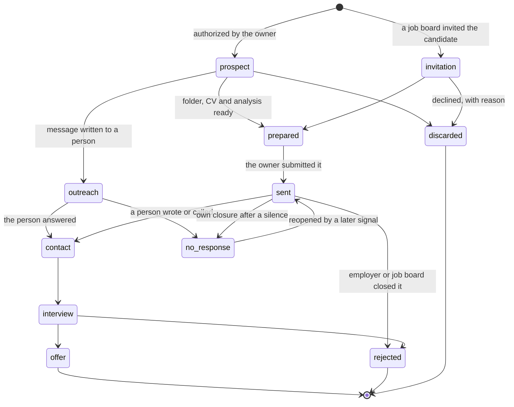

# State machine and closed vocabularies

The pipeline is a YAML file with one entry per opportunity that was **worked** (analyses of postings
that were only read are kept in the triage file). Each entry moves through a fixed set of states.



| State | Meaning |
|---|---|
| `prospect` | authorized, not yet worked |
| `invitation` | a job board invited the candidate; pending a decision (some invitations expire on their own) |
| `outreach` | an **outgoing** direct message was sent; requires a follow-up date and a `connection` event |
| `prepared` | folder, CV and analysis ready; not sent |
| `sent` | submitted (date in `sent`) |
| `contact` | an **incoming** reply from a person (call, message, test) |
| `interview` / `offer` | as named |
| `rejected` | the employer said no — **including** an automatic "process finished" status from a job board |
| `no_response` | **own closure**: the deadline passed with no signal while the job board still shows the application as open |
| `discarded` | decided not to apply, with a reason |

## Two questions every closure answers

The state says *what* happened. Two closed-vocabulary fields say *who* closed it and *why*, because only
that informs the next application:

| `closed_by` | When |
|---|---|
| `board` | an automatic status of the job board ("process finished", posting removed) |
| `employer` | a person or an email from the employer or the recruiting firm |
| `own` | the owner closed it after the follow-up window expired |

| `closure_reason` | When |
|---|---|
| `generic_board` | automatic end of process, no person, no reason — the most common, the least informative |
| `with_feedback` | the employer said why (the reason goes to the notes) |
| `other_candidate` | they declared they chose someone else |
| `conditions` | closed for pay, location, contract or modality — **not** a profile rejection, and excluded from the calibration of the gate |
| `posting_down` | the posting disappeared or the vacancy closed unresolved |
| `silence` | the window expired with no signal — the default for `no_response` |
| `to_classify` | legacy entries without evidence; **debt, not a value** |

Why this matters: before the split, "no response" mixed processes the job board had already closed with
real silences, and the generated board showed as pending processes that were over
([lessons](lessons.md)).

## Rules that protect the state

- **A signal is not a state change.** "Your application was viewed" or "CV downloaded" are recorded as a
  *portal signal* with its literal text, date and strength. Only a person moves the state to `contact`.
- **Never close for silence while the posting is still receiving applications.** A script reads each live
  posting's closing date (over public HTTP) and protects those entries; the follow-up window is counted
  from the posting's close, not from the submission.
- **Reopen, don't leave closed.** If an own closure later receives a signal, the entry goes back to
  `sent` (or `contact`).
- **Closed vocabularies are validated by a script**: modality (`onsite | hybrid | remote | unresolved |
  not_stated`), channel, closure fields. Free text that a generator had to interpret was the source of a
  board that showed "remote" for an onsite job ([ADR 0005](decisions/0005-closed-vocabularies.md)).

## Invented example of an entry

```yaml
# Invented example — not a real application
- id: example-data-engineer
  employer: "Example Manufacturing Co."
  role: "Data Engineer"
  family: N1-5
  state: no_response
  closed_by: own
  closure_reason: silence
  channel_type: board            # board | ats | public_sector | direct
  sent: 2026-09-10
  fit: 68                        # 0–100, employer's view — see metrics.md
  fit_detail: "23/25/15/5"       # functions / seniority / requirements / differentiator
  call_probability: 3            # % estimated BEFORE sending; never edited afterwards
  gaps: ["orchestrator X", "4 years"]      # requirements of THIS posting that the profile lacks
  risks: ["overqualified for the level"]   # distances that are not requirements
  portal_signal: "Viewed"
  signal_date: 2026-09-14
```
