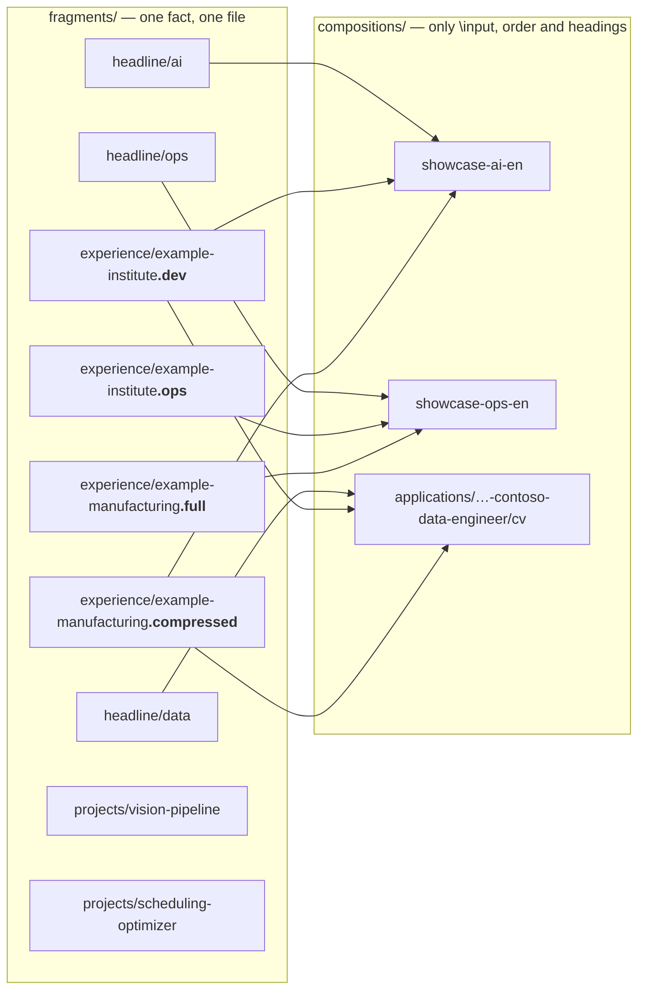
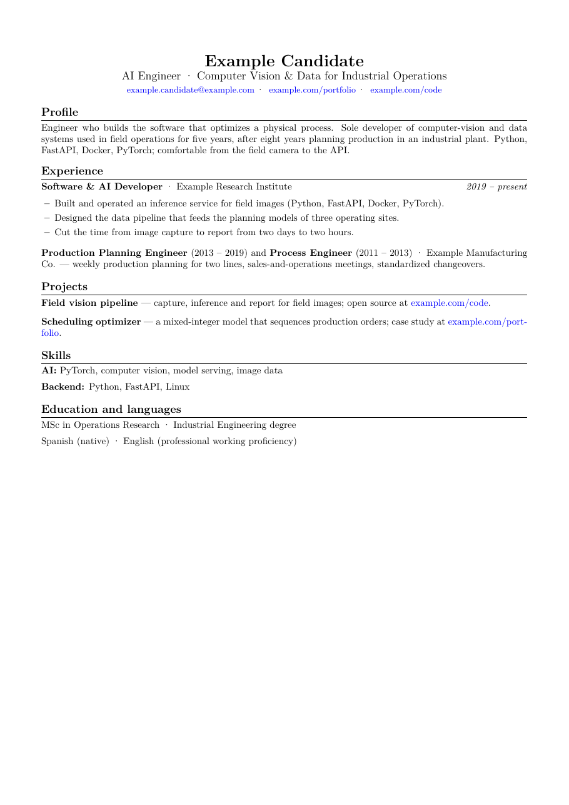
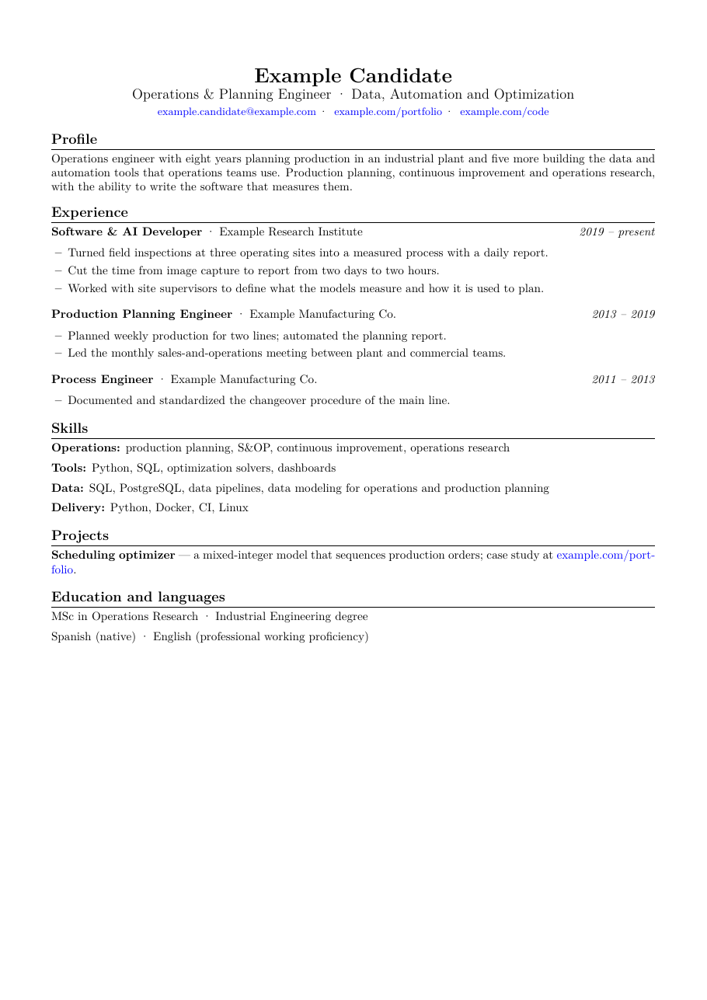
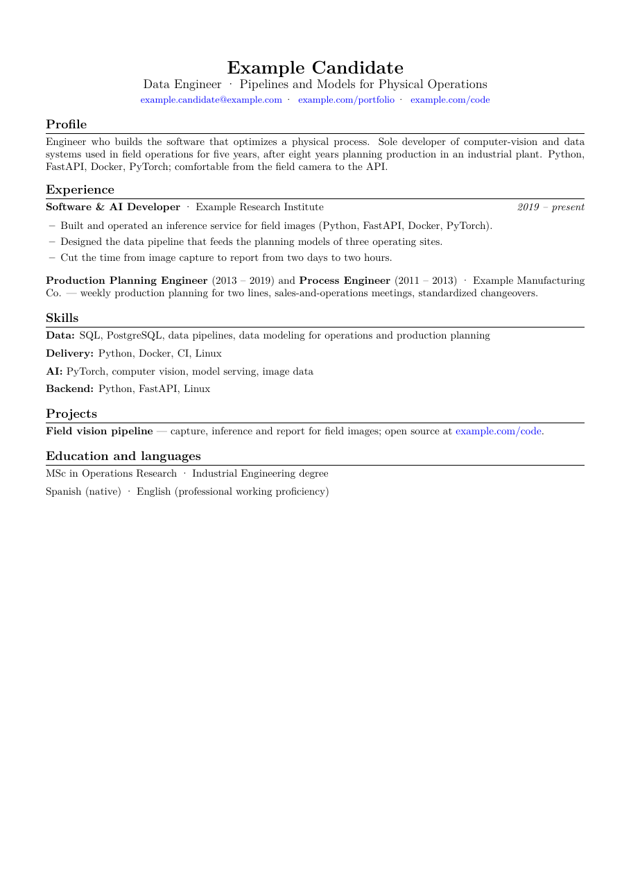

# How a CV is composed — a working LaTeX example

A small, **invented** copy of layers 2 and 3 of the [architecture](../../docs/architecture.md): a fragment
library and three compositions built from it. It compiles, and the build verifies the result the same
way the private build helper does.

```bash
cd examples/latex
./build.sh all            # → out/*.pdf; fails on LaTeX errors, missing glyphs, > 2 pages, unextractable text
```

Needs LuaLaTeX (`fontspec` is used so fonts are embedded with a Unicode map) and poppler
(`pdfinfo`, `pdftotext`).

## The idea in one picture



- **A fragment holds facts.** The current role exists twice — `.dev` (told from the software side) and
  `.ops` (told from the operations side) — with the **same** employer, dates and figures. Only the
  emphasis changes. Older roles exist as `.full` (bullets) and `.compressed` (one block), and both name
  every role ([ADR 0007](../../docs/decisions/0007-every-role-is-named.md)).
- **A composition holds no facts.** It defines the PDF title and keywords (metadata an ATS reads),
  chooses a headline, and `\input`s fragments in an order. Compare
  [`showcase-ai-en.tex`](compositions/showcase-ai-en.tex) with
  [`showcase-ops-en.tex`](compositions/showcase-ops-en.tex): same library, other choices.
- **A per-application CV is just another composition**, in the application's folder:
  [`cv.tex`](compositions/applications/2026-10-12-contoso-data-engineer/cv.tex). The analysis of the
  posting decides the headline, the variants and the order, and the agent explains each choice in a
  [composition report](compositions/applications/2026-10-12-contoso-data-engineer/composition-report.md)
  that the owner accepts or changes. If the CV needs a sentence no fragment has,
  that sentence becomes a new fragment — a fact written inside a composition would be lost for every
  other CV.
- **The point of composing is measurable.** For the invented posting in the application folder
  ([`posting.md`](compositions/applications/2026-10-12-contoso-data-engineer/posting.md)),
  [`reference/ats_coverage.py`](../../reference/ats_coverage.py) gives 81 % for the tailored CV, 65 % for
  the AI showcase and 74 % for the operations one — the same facts, chosen and ordered for the posting.
  The orchestrator it asks for stays missing in all three: the candidate does not have it, so it is a gap.
- **Correcting a fact means editing one file**, and every composition that uses it changes on the next
  build. That is the whole point of the one-way dependency.

## What the three compositions produce

| AI showcase | Operations showcase | One application (Data Engineer) |
|---|---|---|
|  |  |  |

Rendered by [`tools/latex_previews.py`](../../tools/latex_previews.py); each image has a text manifest
like every image in the repository ([`docs/img/README.md`](../../docs/img/README.md)).

## Differences from the private library

The private library has about 80 fragments in two languages (a QA block fails if one language changes without
the other), five showcase compositions (three tracks in Spanish, two of them also in English) and one
composition per application, with a fixed rule: a fragment is justified when two compositions use it. The
application's PDF reaches its `sent/` folder only after the owner read and approved its full text, and is
never rebuilt after being sent ([ADR 0001](../../docs/decisions/0001-human-approval-before-send.md),
[ADR 0006](../../docs/decisions/0006-sent-documents-are-immutable.md)).
